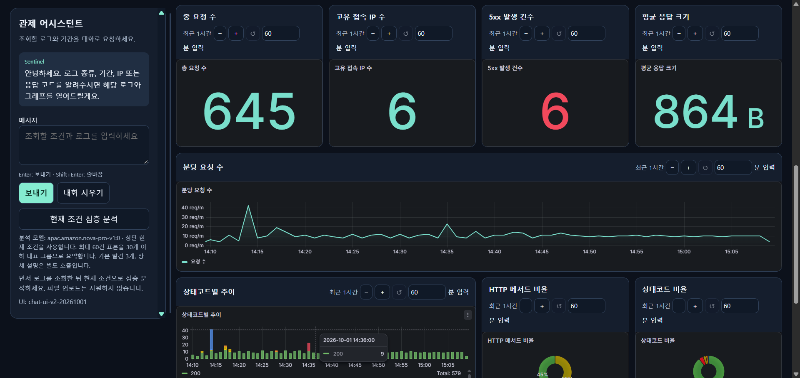
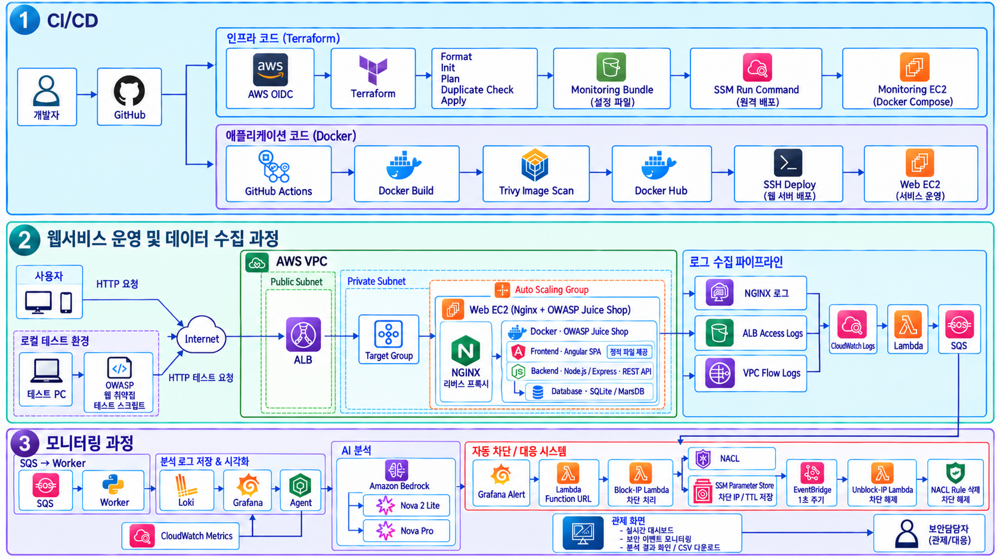
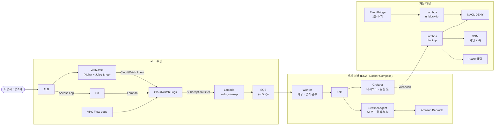
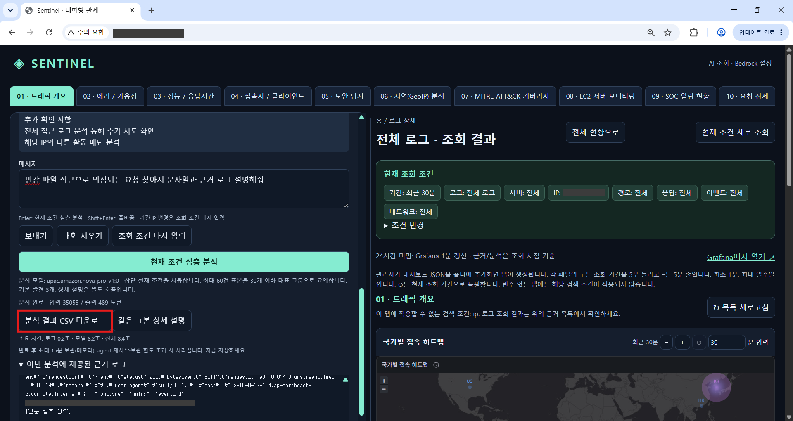
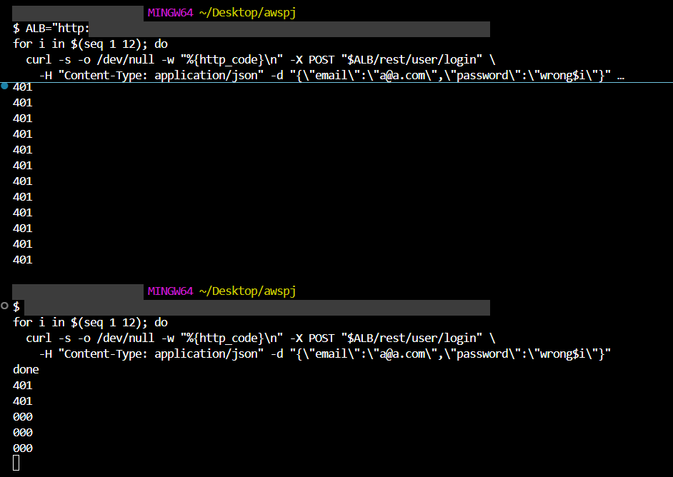
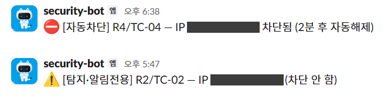
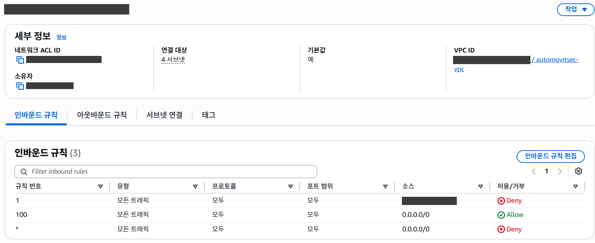

# TeraVibe : Shield Line — AWS 클라우드 보안 관제(SOC) 자동화 플랫폼

> AWS 위에 웹 서비스 인프라를 Terraform으로 구축하고, 로그 수집 → 공격 탐지 → 알림 → **자동 IP 차단**까지 이어지는 실시간 클라우드 보안 관제 파이프라인을 구현한 프로젝트입니다.




## 프로젝트 개요

CrowdStrike의 2026년 위협 헌팅 보고서에 따르면 클라우드를 겨냥한 사이버 범죄 활동은 1년 사이 171% 늘었고, 공개된 취약점이 48시간 안에 악용되는 사례도 많아졌습니다. 공격 속도가 빨라진 만큼, 흩어진 클라우드 로그를 한곳에 모아 실시간으로 탐지하고 즉시 대응하는 체계가 필요하다고 판단했습니다.

클라우드 환경에서는 서버가 Auto Scaling으로 계속 교체되고 로그가 ALB, VPC, 인스턴스 등 여러 곳에 흩어지기 때문에 공격을 한곳에서 보고 빠르게 대응하기 어렵습니다. 이 프로젝트는 다음 세 가지를 목표로 했습니다.

1. **재현 가능한 인프라**: VPC부터 웹 서버, 관제 서버, 대응 Lambda까지 Terraform 한 곳에서 생성·삭제
2. **중앙 집중 관제**: Nginx 접근 로그, ALB 로그, VPC Flow Logs를 하나의 파이프라인으로 모아 실시간 탐지
3. **자동 대응(SOAR)**: 고신뢰 공격은 사람의 개입 없이 출발지 IP를 네트워크 단에서 차단하고 일정 시간 후 자동 해제

공격 대상 서비스로는 의도적으로 취약하게 만들어진 웹 애플리케이션인 **OWASP Juice Shop**을 사용해, 실제 공격 시나리오를 재현하고 탐지·차단 여부를 검증했습니다.

## 아키텍처



<details>
<summary>로그·대응 흐름 다이어그램 (Mermaid)</summary>



</details>

### 네트워크 구성

| 구분 | 구성 |
|---|---|
| VPC | `10.0.0.0/16`, 서울 리전 2개 AZ (2a / 2c) |
| Public Subnet | `10.0.1.0/24`, `10.0.2.0/24` — ALB, NAT Gateway, 관제 EC2 |
| Private Subnet | `10.0.11.0/24`, `10.0.12.0/24` — 웹 서버 ASG (최소 1 · 최대 3대) |
| 라우팅 | Public → Internet Gateway, Private → NAT Gateway (아웃바운드만) |
| Security Group | 인터넷 → ALB SG(80) → Web SG(80, **ALB SG 참조**) 체인. 기본 SG는 규칙 없이 잠금 |

웹 서버 SG는 출발지를 IP 대역이 아닌 ALB 보안 그룹으로 지정해, ALB를 거친 요청만 웹 서버에 도달하고 인스턴스가 교체되어도 규칙이 유지되도록 했습니다.

## 주요 기능

### 1. 로그 수집 파이프라인

세 종류의 로그를 하나의 흐름으로 통합했습니다.

| 로그 | 확인하는 정보 | 수집 방식 |
|---|---|---|
| Nginx 접근 로그 | 요청 경로, 상태 코드, User-Agent (애플리케이션 계층) | CloudWatch Agent, JSON 포맷 |
| ALB 접근 로그 | 클라이언트 IP, 요청·대상·응답 처리 시간 | S3 적재 → Lambda → CloudWatch Logs |
| VPC Flow Logs | IP·포트 단위 트래픽, 허용·거부 여부 | 60초 단위로 CloudWatch Logs |

웹 서버의 Nginx는 탐지에 필요한 필드를 JSON으로 기록하고, `realip` 설정으로 VPC(ALB)에서 온 `X-Forwarded-For`만 신뢰해 헤더 위조로 IP별 탐지를 속일 수 없게 했습니다. ALB 헬스체크 요청은 로그에서 제외해 탐지가 오염되지 않도록 했습니다. CloudWatch Agent 설정은 SSM Parameter Store에 두어 ASG가 인스턴스를 교체해도 새 인스턴스가 같은 설정을 받아 수집이 끊기지 않습니다.

모든 로그는 Subscription Filter → Lambda → **SQS**를 거쳐 관제 서버로 전달됩니다. SQS를 버퍼로 둔 이유는 트래픽 급증을 흡수하고, 관제 서버가 잠시 멈추거나 재시작되어도 로그가 유실되지 않게 하기 위해서입니다. Worker는 Loki가 저장 성공(HTTP 204)을 응답한 경우에만 메시지를 삭제하고, 5회 연속 처리에 실패한 메시지는 DLQ로 격리됩니다.

### 2. 공격 탐지

Worker가 로그를 파싱하면서 요청 URI와 User-Agent를 정규식 시그니처로 검사해 `attack_type` 라벨(sqli, xss, path_traversal, sensitive_file, scanner, normal)을 붙입니다. 이중 URL 인코딩 우회를 막기 위해 URI를 두 번 디코딩한 뒤 매칭하며, SQL 인젝션 페이로드에 500 응답이 함께 나오면 `success_suspect` 필드로 공격 성공 의심을 표시합니다. 응답 코드만으로 성공을 단정하지는 않습니다.

Grafana Alerting에는 6개의 탐지 룰을 프로비저닝 파일로 정의했습니다. 모든 룰은 1분 윈도우로 30초마다 출발지 IP별로 평가하며, 각 시나리오를 MITRE ATT&CK 기법에 매핑했습니다.

| 룰 | 시나리오 | MITRE ATT&CK | 조건 (1분 기준) | 대응 |
|---|---|---|---|---|
| R1 | 경로 스캔 | — | 404 응답 30건 이상 | 알림 + **자동 차단** |
| R2 | 민감 파일 접근 (`.env`, `.git` 등) | T1595.003 | 1건 이상 | 알림 |
| R3 | 로그인 무차별 대입 | T1110 | 로그인 API 401 응답 10건 이상 | 알림 + **자동 차단** |
| R4 | SQL 인젝션 | T1190 | 1건 이상 | 알림 + **자동 차단** |
| R5 | XSS | T1059.007 | 1건 이상 | 알림 |
| R6 | 경로 순회 | T1190 | 1건 이상 (ALB 400 1차 차단 후 우회분) | 알림 |

반복 기반 공격(무차별 대입, SQL 인젝션)만 자동 차단하고, 정상 사용자나 봇도 우연히 일으킬 수 있는 단건 기반 공격(민감 파일, XSS, 경로 순회)은 알림만 보내도록 분리해 오차단 위험을 줄였습니다.

### 3. 자동 차단 (SOAR)

차단 대상 룰이 발생하면 Grafana가 Webhook으로 `block-ip` Lambda의 Function URL을 호출하고, Lambda는 ALB가 위치한 퍼블릭 서브넷의 **NACL에 DENY 규칙**을 추가합니다. 차단 기록(IP, 만료 시각)은 SSM Parameter Store에 남고, EventBridge가 1분마다 `unblock-ip` Lambda를 실행해 만료된 차단을 해제합니다. 탐지부터 차단, 해제까지 사람의 개입 없이 동작합니다.

자동 차단은 잘못 동작하면 서비스 장애로 이어지기 때문에 여러 안전장치를 두었습니다.

- **호출 인증**: Terraform이 생성한 Bearer 비밀 토큰이 일치할 때만 동작하며(불일치 시 403), 토큰은 코드나 Git에 남지 않습니다.
- **단일 IP만 차단**: `/32` 단일 IPv4만 허용하고 대역, `0.0.0.0`, 루프백, 멀티캐스트, 예약 대역은 거부합니다.
- **화이트리스트**: VPC 내부 대역(`10.0.0.0/16`)은 차단에서 제외합니다.
- **멱등성**: 이미 차단된 IP는 다시 차단하거나 기간을 연장하지 않습니다.
- **NACL 한도 관리**: 인바운드 규칙 수 상한(20개)을 넘으면 차단을 거부하고 Slack으로 경고합니다.
- **안전한 해제**: NACL 규칙 삭제가 성공한 경우에만 SSM 기록을 지워 고아 규칙을 막고, 실패하면 다음 1분 주기에 재시도합니다.

### 4. AI 기반 로그 검색·분석 (Sentinel)



관제 담당자가 LogQL을 몰라도 "최근 1시간 동안 로그인 실패가 많은 IP"처럼 자연어로 로그를 조회하고 분석할 수 있는 웹 UI를 만들었습니다. Amazon Bedrock은 두 단계로 나눠 사용합니다.

| 단계 | 역할 | 설계 |
|---|---|---|
| 1차 · 검색 조건 해석 | 한국어 질문 → 허용된 필드만 가진 JSON 검색 계획 | temperature 0, 짧은 출력. 호출이 잦아 가볍고 저렴한 모델 사용 |
| 2차 · 심층 분석 | 조회된 로그 표본(최대 60건) → 요약·발견 사항·근거 로그·판단 불가 사항 | 긴 입력과 근거 비교가 필요해 상위 모델(Nova Pro) 사용 |

모델은 검색 계획만 만들고, 실제 LogQL은 서버가 검증된 값으로 직접 생성합니다. 분석 프롬프트는 로그 안의 지시를 따르지 않도록 제한하고, 응답이 정해진 JSON 스키마와 다르거나 제공하지 않은 근거 로그 ID를 인용하면 서버가 결과를 거부합니다. AI 에이전트에는 NACL이나 SSM 쓰기 권한이 없어, 탐지·차단과 조회·분석의 책임이 분리되어 있습니다. 모델 ID를 비워두면 AI 없이 키워드 검색으로 동작합니다.

최대 7일 범위를 조회해도 관제 서버가 과부하되지 않도록 1시간 단위 분할 집계, 5분 캐시, Loki 동시 요청 제한(2개), 응답 크기 제한(16MiB), 심층 분석 동시 1건·30초 간격 제한을 적용했습니다.

### 5. 관제 대시보드

Grafana 대시보드 10종을 JSON으로 프로비저닝해, 관제 서버를 새로 만들어도 동일한 화면이 자동으로 구성됩니다. Sentinel 웹 UI에서 탭으로 통합해 볼 수 있습니다.

| 대시보드 | 내용 |
|---|---|
| 01 트래픽 개요 / 02 에러·가용성 / 03 성능 | 서비스 상태와 응답 시간 |
| 04 접속자 / 06 GeoIP | 클라이언트 및 지역별 접근 분석 |
| 05 보안 탐지 / 09 SOC 알림 현황 | 공격 유형별 탐지 현황과 알림 이력 |
| 07 MITRE ATT&CK 커버리지 | 탐지 룰과 ATT&CK 기법 매핑 |
| 08 EC2 서버 모니터링 | 인프라 리소스 상태 |
| 10 요청 상세 | 개별 요청 드릴다운 |

### 6. DevSecOps CI/CD

GitHub Actions 워크플로를 변경 경로별로 분리해, 앱 수정이 인프라 배포를 건드리지 않고 AWS 권한도 인프라 트랙에만 부여했습니다.

- **Track A (`terraform/**`)**: GitHub OIDC로 AWS 역할을 수임해 세션 동안만 유효한 임시 자격 증명을 받고(장기 액세스 키 미저장), 필수 시크릿과 관리자 IP 형식 검증 → `fmt` → `init` → `plan` → state 밖에 같은 이름의 VPC가 있으면 중단하는 중복 인프라 가드 → 저장된 plan 그대로 `apply` 순으로 진행합니다. 관제 설정이 바뀌면 번들을 S3에 올리고 SSM Run Command로 관제 EC2에 재배포해, 인스턴스 교체 없이 설정만 갱신합니다.
- **Track B (`app/**`)**: Docker 이미지를 빌드하고 Docker Hub에 올리기 전에 **Trivy**로 CRITICAL·HIGH 등급 취약점을 스캔해 결과를 기록한 뒤, SSH로 웹 서버에 배포합니다.

배포된 서비스는 OWASP ZAP으로도 점검했으며 High 0건, Medium 2건(CSP 헤더, 클릭재킹 방지 헤더 미설정), Low 1건(Server 헤더 버전 노출)이 확인되었습니다.

## 공격 시나리오 검증

`attack-scripts/`의 스크립트로 각 룰을 실제로 발생시켜 탐지와 차단을 확인했습니다.

| 스크립트 | 시나리오 | 룰 | 결과 |
|---|---|---|---|
| `r2_sensitive_file.sh` | `.env`, `.git/config`, `.aws/credentials` 요청 | R2 | Slack 알림 (차단 안 함) |
| `r3_bruteforce.sh` | 로그인 실패 12회 (POST + JSON) | R3 | Slack 알림 + 출발지 IP NACL 차단 |
| `r4_sqli.sh` | `' OR 1=1--`, `UNION SELECT` 등 3건 | R4 | 500 응답에 `success_suspect` 표시 + NACL 차단 |
| `r5_xss.sh` | `<script>`, `onerror=` 등 3건 | R5 | Slack 알림 |
| `r6_path_traversal.sh` | 쿼리에 숨긴 `../../etc/passwd` 등 3건 | R6 | ALB 400 1차 차단 + 우회분 탐지·알림 |

**무차별 대입 차단 확인** — 1회차 12건은 모두 401이 반환되어 R3가 발동하고, 2회차에서는 401 두 건 뒤 `000`(응답 없음)이 반환됩니다. NACL이 패킷을 버려 TCP 연결 자체가 맺어지지 않는 것으로, 앞의 401 두 건이 탐지·차단 반영까지 걸린 시간입니다.



**Slack 알림과 NACL 차단 규칙** — 차단 룰은 `[자동차단]`, 알림 전용 룰은 `[탐지·알림전용]`으로 구분되어 전송되고, NACL 인바운드 규칙 1번에 공격 IP의 DENY 규칙이 추가됩니다.





### 탐지·대응 소요 시간

| 구간 | 소요 시간 | 근거 |
|---|---|---|
| 공격 → Nginx → CloudWatch → Lambda → SQS → Worker → Loki | 수 초 | 구독 필터 즉시 호출, SQS 롱폴링 |
| Grafana 룰 평가 | 최대 30초 | 평가 주기 30초, 조건 충족 즉시 발동 |
| 알림·차단 실행 | 수 초 | Function URL 직접 호출, NACL 규칙 추가 |
| **탐지 완료 (MTTD)** | **약 30초 ~ 1분** | |
| 자동 해제 | TTL 2분 + 최대 1분 | EventBridge 1분 주기 |

## 기술 스택

| 영역 | 사용 기술 |
|---|---|
| Infrastructure | AWS VPC, ALB, EC2 Auto Scaling, NAT Gateway, NACL, IAM, S3, SSM |
| IaC | Terraform (AWS Provider 6.x, S3 원격 상태) |
| Log Pipeline | CloudWatch Logs·Agent, VPC Flow Logs, Lambda, SQS (+DLQ) |
| SOC Stack | Grafana 13, Loki 3, Python Worker, Nginx Gateway, Docker Compose |
| Response | Lambda (block/unblock), Function URL, EventBridge, Slack |
| AI | Amazon Bedrock (Amazon Nova, Converse API) |
| CI/CD · 보안 점검 | GitHub Actions, GitHub OIDC, Trivy, OWASP ZAP |
| Target | OWASP Juice Shop v17.3.0 |

## 디렉터리 구조

```
.
├── terraform/                  # 전체 인프라 (단일 Terraform 루트)
│   ├── main.tf                 # VPC · 서브넷 · 라우팅 · 보안 그룹 · Flow Logs
│   ├── ec2_target.tf           # 웹 ASG · ALB · CloudWatch Agent 설정
│   ├── iam.tf                  # 웹 서버 IAM 역할
│   ├── monitoring_infra.tf     # CloudWatch → Lambda → SQS 파이프라인
│   ├── multilog.tf             # ALB · VPC 로그 통합 수집
│   ├── monitoring_server.tf    # 관제 EC2 · EBS · IAM · 배포 번들 · Bedrock 권한
│   ├── auto_block.tf           # 자동 차단 · 해제 Lambda, EventBridge
│   ├── lambda/                 # Lambda 소스 (alb-to-cloudwatch, cw-logs-to-sqs, block-ip, unblock-ip)
│   └── user_data/web.sh        # Nginx(JSON 로그 · realip) + Juice Shop
├── monitoring-integrated/
│   ├── runtime/                # 관제 서버 Docker Compose 스택
│   │   ├── worker/             # SQS 소비 · 로그 파싱 · 공격 분류
│   │   ├── agent/              # Sentinel AI 검색 · 분석
│   │   ├── grafana/            # 대시보드 10종 · 알림 룰 프로비저닝
│   │   ├── loki/               # Loki 설정
│   │   └── gateway/            # Nginx 리버스 프록시
│   ├── scripts/                # 설치 · 로컬 실행 스크립트
│   └── tests/                  # Python · Node 테스트
├── attack-scripts/             # 공격 시나리오 재현 스크립트
├── app/                        # 웹 앱 컨테이너 소스
├── scripts/                    # 전체 인프라 정리(destroy) 스크립트
├── docs/                       # 배포 가이드 · 검증 기록 · 성능 개선 노트 · 이미지
└── .github/workflows/          # Track A (인프라) · Track B (앱) 파이프라인
```

## 배포 방법

자세한 절차는 [`docs/DEPLOYMENT-GUIDE.ko.md`](docs/DEPLOYMENT-GUIDE.ko.md)를 참고하세요. 요약하면 다음과 같습니다.

```bash
# 1. 변수 파일 준비 (key_name, admin_cidr 등 입력)
cd terraform
cp terraform.tfvars.example terraform.tfvars

# 2. 원격 상태 버킷 지정 (backend.hcl은 커밋되지 않음)
cp backend.hcl.example backend.hcl

# 3. 인프라 생성
terraform init -backend-config=backend.hcl
terraform plan -out=unified.tfplan
terraform apply unified.tfplan

# 4. 관제 서버 접속 (8080 포트를 외부에 열지 않고 SSH 터널 사용)
ssh -i <key>.pem -N -L 18080:127.0.0.1:8080 ubuntu@$(terraform output -raw public_ip)
# http://localhost:18080
```

> ⚠️ NAT Gateway, ALB, EC2 등 과금 리소스가 생성됩니다. 테스트 후에는 `terraform destroy` 또는 `scripts/destroy-all.ps1`로 정리하세요.

## 보안 설계 포인트

- **최소 권한 IAM**: 역할별로 필요한 권한만 부여했습니다. 로그 수집 Lambda는 처음 `AmazonSQSFullAccess`를 쓰던 것을 특정 큐에 대한 `sqs:SendMessage` 하나로 줄였고, 차단 Lambda의 SSM 권한은 차단 기록 경로(`/blocklist/*`)로 한정했으며, Bedrock 호출도 와일드카드 없이 지정한 모델 ARN으로 제한했습니다.
- **인스턴스 보호**: 웹 서버는 IMDSv2를 강제하고 EBS를 암호화했으며, Juice Shop 컨테이너는 `127.0.0.1`에만 바인딩해 Nginx를 거쳐야만 접근할 수 있습니다.
- **관제 서버 비공개**: 대시보드는 기본적으로 외부에 열지 않고 SSH 터널로만 접속하며, 허용 IP를 지정해도 `0.0.0.0/0`은 변수 검증 단계에서 거부합니다.
- **컨테이너 하드닝**: Worker와 Agent 컨테이너는 읽기 전용 파일시스템, 모든 Linux capability 제거, `no-new-privileges`로 실행합니다.
- **비밀 정보 관리**: tfvars, state, backend 설정, `.env`, 키 파일은 Git에서 제외하고, 비밀번호와 토큰은 Terraform이 생성하거나 SSM SecureString에 저장합니다. 계정 ID나 리소스 ID는 코드에 하드코딩하지 않고 런타임에 조회합니다.

## 트러블슈팅

**로그인 무차별 대입이 탐지되지 않던 문제**
GET 방식으로 로그인 요청을 보내면 Juice Shop이 401이 아닌 500을 반환해 R3 조건에 걸리지 않았습니다. 실제 로그인과 같은 POST + JSON 형식으로 요청하도록 공격 스크립트를 수정해 해결했습니다.

**경로 순회 공격이 서버까지 도달하지 않던 문제**
`/../../etc/passwd` 형태의 경로는 ALB가 자체적으로 400을 반환해 웹 서버 로그에 남지 않았습니다. 이를 ALB의 1차 방어로 보고, `../`를 쿼리 문자열에 숨긴 우회형 요청은 SOC가 탐지하는 다층 방어 구조로 정리했습니다.

**분리된 Terraform 구성의 통합**
초기에는 웹 인프라와 관제 서버가 별도 Terraform 구성이어서 VPC ID, 서브넷, SQS URL을 수동으로 옮겨야 했고 상태 파일도 따로 관리됐습니다. 이를 단일 루트로 통합해 리소스를 직접 참조하도록 바꾸고, 관제 서버가 인터넷 경로가 생기기 전에 초기 설치를 시작하지 않도록 의존성을 명시했습니다.

**장기간 로그 조회 시 관제 서버 과부하**
7일 범위 조회 시 Loki가 전체 로그를 한 번에 읽으면서 메모리와 응답 시간이 급증했습니다. 1시간 단위 분할 집계, 조회 결과 캐시, 동시 요청 제한, 장기 조회 시 Grafana 자동 갱신 중지를 적용해 부하를 제어했습니다.

## 한계 및 개선 방향

- **배포 게이트**: 현재 Trivy는 스캔 결과를 기록만 하고 배포를 막지 않습니다. CRITICAL 취약점 발견 시 배포를 중단하고 이미지 버전 태그를 관리하는 방향으로 강화할 수 있습니다.
- **자동 대응 단계화**: 지금은 TTL 기반 임시 차단만 자동이며 재범 가중치나 영구 차단 정책이 없습니다. 1차 차단은 자동, 영구 조치는 승인 후 적용하는 구조를 고려하고 있습니다.
- **탐지 범위 확대**: 공격 분류가 정규식 시그니처 기반이라 새로운 우회 기법에는 한계가 있습니다. CloudTrail, AWS WAF, GuardDuty 연동과 ATT&CK 매핑 확대가 다음 단계입니다.
- **AI 분석**: 분석은 사용자가 요청할 때 동작하며 이벤트 발생 시 자동으로 시작하지는 않습니다. 프롬프트 템플릿 표준화와 분석 정확도 검증이 필요합니다.
- **관제 스택 가용성**: 관제 스택이 단일 EC2에서 동작하므로, 운영 환경이라면 Loki 스토리지를 S3로 분리하고 고가용성 구성을 고려해야 합니다.

## Team

**TeraVibe** — 4인 팀 프로젝트
